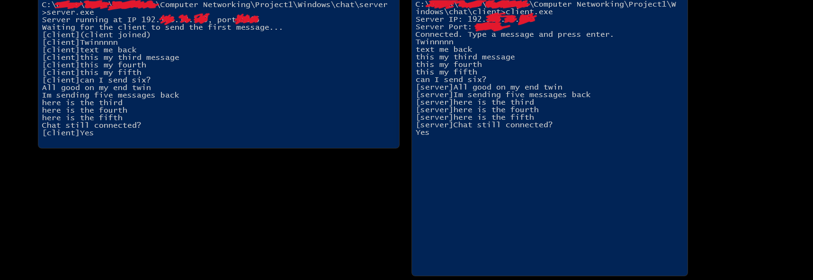

## UDP Chat

### Features
- Server auto picks a free port and prints its IP adrress along with port.
- Client connects to chat using the IP and port provided by the server.
- Asynchronous sending and receiving running in seperate threads.
- Works across two machines on the same network.
- Uses raw UDP socket API (SOCK_DGRAM), without any networking libraries.

### How does it work?
Because UDP is connectionless, there is no handshake. The order is:

- The server creates a UDP socket and binds to port 0, allowing the OS to choose a free port.
- The client creates its own UDP socket and sends a "joined" packet to the server IP and port.
- The server records the client address from the "joined" packet, which is how it learns where to send the replies.
- Each side runs a background thread on recvfrom() while the main thread reads input and calls sendto().

### Requirements
- Windows / Linux
- C++20
- 1-2 Machines

### Build
- g++ -std=c++20 -Wall -Wextra server.cpp -o server.exe -lws2_32
- g++ -std=c++20 -Wall -Wextra client.cpp -o client.exe -lws2_32

### Testing

